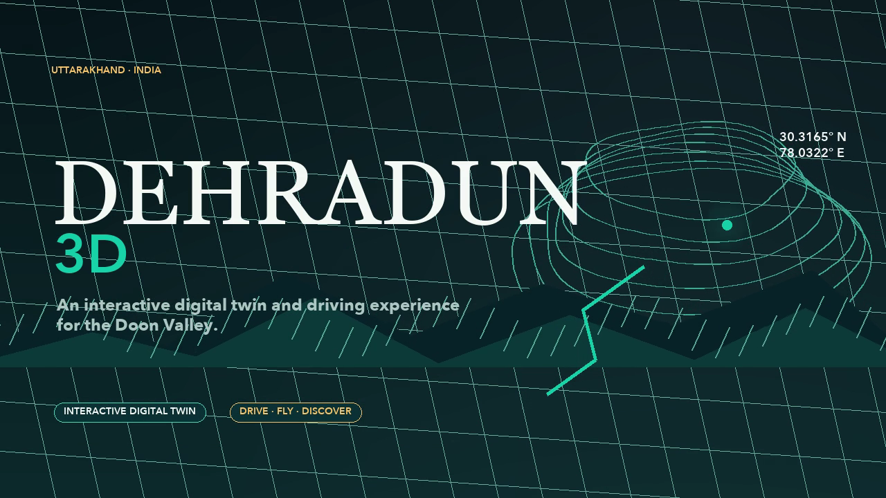
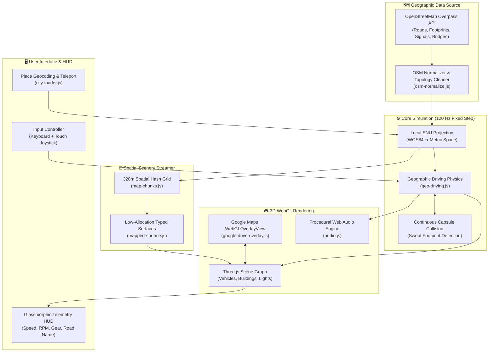

<div align="center">

# 🏔️ Dehradun Drive 3D
### A Real-Time 3D Geographic Driving Simulator through Surveyed Dehradun Streets

[](https://github.com/Harshit17x/Dehradun-3d-game/stargazers)
[](https://github.com/Harshit17x/Dehradun-3d-game/network/members)
[](https://github.com/Harshit17x/Dehradun-3d-game)
[](https://threejs.org/)
[](https://vitejs.dev/)
[](https://www.openstreetmap.org/)
[](https://developers.google.com/maps/documentation/javascript/webgl/webgl-overlay-view)
[](./LICENSE)
[](https://github.com/Harshit17x/Dehradun-3d-game/pulls)

<br/>

**[✨ Key Features](#-key-features)** •
**[🏎️ The Garage](#-the-garage)** •
**[📍 Road Network](#-road-network--landmarks)** •
**[🕹️ Controls](#-controls)** •
**[⚡ Quick Start](#-quick-start)** •
**[🚀 Deployment](#-deployment--hosting)** •
**[🏗️ Architecture](#-system-architecture)** •
**[🗺️ Data Provenance](#-data-provenance--accuracy)**

<br/>

<a href="#-quick-start">
  
</a>

<p align="center">
  <em>Experience the heart of Uttarakhand in your browser. Cruise past the historic Clock Tower (Ghanta Ghar), accelerate down Rajpur Road, and navigate real surveyed streets in real-time WebGL 3D.</em>
</p>

---

</div>

<br/>

## 🌟 Why Dehradun Drive?

Most web-based driving games rely on artificial, fictional grid worlds. **Dehradun Drive** places you directly onto surveyed roads in Uttarakhand, India (`30.24–30.43° N`, `77.94–78.17° E`). By seamlessly bridging **Google Maps Vector 3D (WebGLOverlayView)**, **OpenStreetMap GIS datasets**, and **Three.js**, it delivers a geographically anchored, responsive driving simulation.

---

## ✨ Key Features

<table>
<tr>
<td width="50%" valign="top">

### 🗺️ Surveyed Geographic GIS Engine
- **Real OSM Topology**: Every road, lane, roundabout, and flyover is generated from actual OpenStreetMap vector data — not artificial grids.
- **Closed Building Footprints**: Procedural architecture extruded faithfully from surveyed parcel boundaries.
- **Street Infrastructure**: Mapped traffic signals, pedestrian crossings, access barriers, and illuminated street lamps.

</td>
<td width="50%" valign="top">

### ⚡ Google Maps Vector 3D Integration
- **WebGLOverlayView**: Three.js renders directly inside Google's vector 3D canvas with shared WebGL contexts.
- **Local ENU Coordinates**: Sub-millimeter geographic coordinate translation from WGS84 (Lat/Long) to local East-North-Up space.
- **Dynamic Terrain Fusion**: Google 3D imagery and terrain contours seamlessly align with driving physics.

</td>
</tr>
<tr>
<td width="50%" valign="top">

### ⏱️ Custom 120Hz Continuous Physics
- **Zero Heavy Physics Bloat**: Hand-crafted 120 Hz deterministic physics running with zero external physics engine overhead.
- **Continuous Collision Detection (CCD)**: Swept 2.4m capsule boundary checks prevent tunneling through thin walls or curbs.
- **Sidewalk Glancing & Sweep**: Natural sliding upon glancing impacts with roadside boundaries and curbs.

</td>
<td width="50%" valign="top">

### 🧩 Spatial Chunking & 60 FPS Streaming
- **320m Spatial Hash Grid**: World geometry streams dynamically around your vehicle in nearest-first priority.
- **Hysteresis Unloading**: Active load radius (720m) and unload threshold (980m) ensure ultra-stable 60 FPS and low memory usage.
- **Persistent Collision Network**: Whole-city road collision remains active at all times, even while visual meshes stream.

</td>
</tr>
<tr>
<td width="50%" valign="top">

### 🌓 Day / Night Cycle & Dynamic Lighting
- **Real-Time Celestial Lighting**: Transition between crisp valley daylight, sunset over the Shivalik range, and starry night.
- **Functional Vehicle Lights**: Dual forward casting headlights, dynamic reverse/brake tail-lights, and streetlamp illumination.
- **Himalayan Mountain Ambiance**: Atmospheric scattering and mountain silhouettes enveloping the Doon basin.

</td>
<td width="50%" valign="top">

### 🔊 Procedural Web Audio Engine
- **Harmonic Engine Synthesis**: Multi-oscillator audio dynamically modulated by real-time vehicle RPM, throttle, and speed.
- **Acoustic Feedback**: Tire squeal on aggressive drifts, brake friction, turbo spool whine, and ambient mountain breeze.
- **Zero Audio Assets**: Ultra-lightweight procedural Web Audio API synthesis without downloading large audio files.

</td>
</tr>
<tr>
<td width="50%" valign="top">

### 📍 3D GPS Route Tracker & Road Navigation Line
- **Glowing Navigation Ribbon**: Search or select any destination in Dehradun to plot an animated 3D navigation line elevated 0.28m above surveyed asphalt.
- **Surveyed OSM A* Pathfinding**: Bounded graph routing traversing 18,000+ real road segments with zero off-road clipping.
- **Sky Beacon & 3D Waypoint Pin**: 18-meter glowing cyan light pillar and spinning diamond marker pin visible across the valley.

</td>
<td width="50%" valign="top">

### 🧭 Real-Time Navigation Telemetry & HUD
- **Dynamic Route Telemetry**: Glassmorphic HUD banner displaying destination name, distance in meters/km, and estimated travel time (ETA).
- **Arrival Detection & Harmonic Chimes**: Automatic proximity trigger (<= 14m) with melodic clock tower bell celebration.
- **Instant Landmark Autocomplete**: Built-in suggestions for top spots (*Clock Tower*, *Pacific Mall*, *Survey Chowk*, *Mussoorie Bus Stand*, *Kumar Sweets*).

</td>
</tr>
</table>

---

## 🏎️ The Garage

Switch vehicles on the fly from the telemetry HUD:

| Vehicle | Model | Handling Characteristics | Dynamic Features |
| :--- | :--- | :--- | :--- |
| **🏎️ 2024 BMW M4 Competition** | High-Poly GLB | Aggressive acceleration, responsive cornering, 60 km/h cruising | Dual twin headlights, metallic finish, spinning alloy wheels |
| **🚓 Uttarakhand Police Interceptor** | Low-Poly GLB | Rapid steering response, agile city patrol tuning | Siren beacons, high-visibility roof bar, police livery |
| **⚡ Ember GT Prototype** | Procedural Mesh | Balanced electric drive, smooth torque curve, immediate throttle | Aerodynamic profile, neon emissive accents, regenerative braking |

---

## 📍 Road Network & Landmarks

Drive across authentic surveyed roads centered on Dehradun's geographic origin (`30.32448° N`, `78.04187° E`):

```
                   🏔️ Rajpur Road & Mussoorie Highway (North)
                                      │
           🛣️ Chakrata Road ───────── 🏛️ ───────── 🛍️ Paltan Bazaar
                 (West)          Clock Tower           (South-East)
                                (Ghanta Ghar)
                                      │
                          Gandhi Road & Railway Hub
```

- **🏛️ Ghanta Ghar (Clock Tower)**: The historic beating heart and central traffic roundabout of Dehradun. An accurate six-faced hexagonal tower with chiming clock dials at the crossroads of Rajpur, Paltan, and Chakrata roads.
- **🛣️ Rajpur Road & Rajpur-Mussoorie Highway**: The primary highway corridor leading northward into the foothills of the Himalayas.
- **🛍️ Paltan Bazaar**: Historic marketplace streets with mapped vendor buildings, street stalls, and bustling pedestrian avenues.
- **🛣️ Chakrata Road**: Major commercial corridor extending west from the Clock Tower roundabout.
- **🔍 Real-Time Citywide Search & Teleport**: Enter any Dehradun place (e.g. *FRI*, *Dalanwala*, *Jakhan*, *Ballupur*, *Sahastradhara Road*, *Pacific Mall*) in the HUD search bar to dynamically stream its bounded OSM cell and spawn directly onto the nearest road.

---

## 🕹️ Controls

### ⌨️ Keyboard Controls

| Key | Action | Details |
| :---: | :--- | :--- |
| <kbd>W</kbd> / <kbd>↑</kbd> | **Accelerate** | Drive forward (capped at 60 km/h); releases reverse brake |
| <kbd>S</kbd> / <kbd>↓</kbd> | **Brake / Reverse** | Decelerates to a complete stop, then shifts into reverse (18 km/h cap) |
| <kbd>A</kbd> / <kbd>←</kbd> | **Steer Left** | Speed-sensitive steering with automatic decay and counter-steer |
| <kbd>D</kbd> / <kbd>→</kbd> | **Steer Right** | Speed-sensitive steering with automatic decay and counter-steer |
| <kbd>Space</kbd> | **Handbrake** | Instant brake to halt with dynamic tire friction |
| <kbd>Shift</kbd> | **Turbo Boost** | Increases acceleration curve on open highway stretches |
| <kbd>H</kbd> | **Toggle Headlights** | Toggles forward projector beams and rear tail lamps |
| <kbd>N</kbd> | **Day / Night Cycle** | Switches lighting between Valley Daylight and Starry Himalayan Night |
| <kbd>C</kbd> | **Chase Camera** | Close behind-the-car driving camera with smooth angular damping |
| <kbd>O</kbd> | **Wide / Orbit Camera** | High-angle bird's-eye camera providing full road context |
| <kbd>V</kbd> | **Preview Camera** | Close-up beauty camera highlighting vehicle details |
| <kbd>P</kbd> | **Pause / Resume** | Freezes simulation and fixed-step updates |
| <kbd>R</kbd> | **Reset Car** | Respawn car facing North on Rajpur Road near Clock Tower |
| <kbd>Esc</kbd> | **Clear Route** | Cancels active GPS navigation tracker line & guidance HUD |

### 📱 Touch & Mobile Controls
- **On-Screen D-Pad**: Automatic touch joystick and button layout enabled on mobile, iPad, and coarse pointer screens.
- **Interactive HUD**: Tap to switch camera modes, vehicle models, time of day, audio, or search any Dehradun landmark.

<br/>

> [!TIP]
> **💡 Pro-Tip for Driving & Getting Unstuck:**  
> Dehradun 3D uses **continuous capsule collision detection** to prevent tunneling through real-world curbs and building walls. If you nose into a curb or wall, **do not hold steer (<kbd>A</kbd>/<kbd>D</kbd>) while reversing**, as turning swings the rear bumper into the sidewalk boundary.  
> **To unstick:** Release <kbd>A</kbd>/<kbd>D</kbd> and tap <kbd>S</kbd> with **straight wheels** to back out cleanly, or press <kbd>R</kbd> to instantly reset to Rajpur Road.

---

## ⚡ Quick Start

Get the simulation running locally in under **60 seconds**:

### 1. Clone the repository
```bash
git clone https://github.com/Harshit17x/Dehradun-3d-game.git
cd Dehradun-3d-game
```

### 2. Install dependencies
```bash
npm install
```

### 3. Start development server
```bash
npm run dev
```
Open **[http://localhost:5173](http://localhost:5173)** in your browser and start driving!

<br/>

### 🔑 Google Maps Vector 3D Setup (Optional)
The project runs out-of-the-box locally. To enable custom Google Maps Vector 3D aerial tiles:
1. Copy the example environment file:
   ```bash
   cp env.example .env
   ```
2. Add your Google Maps JavaScript API key and Vector Map ID:
   ```env
   VITE_GOOGLE_MAPS_API_KEY=your_google_maps_api_key_here
   VITE_GOOGLE_MAP_ID=your_vector_map_id_here
   ```
> **Security Note**: API keys are securely served via Vite's local runtime endpoint (`/api/maps-config`) and are **never** committed or baked into public source files.

---

## 🛠️ Available Scripts

| Command | Description |
| :--- | :--- |
| `npm run dev` | Starts the high-speed Vite dev server with hot module replacement (HMR) |
| `npm run build` | Compiles production assets into `dist/` and `dist-drive/` and builds the standalone snapshot |
| `npm run preview` | Serves the production build with local `/api/maps-config` emulation |
| `npm test` | Runs the full 42-test Node.js automated test suite across geographic physics and GIS |
| `npm run fetch:map` | Refreshes the full Dehradun OSM dataset (`30.24–30.43° N`, `77.94–78.17° E`) via Overpass API |
| `npm run fetch:central` | Fetches a lightweight central-city extract for rapid local testing |

---

## 🚀 Deployment & Hosting

Dehradun 3D can be hosted for **free** across several modern platforms:

### 1. ⚡ Vercel (Recommended — Fastest Setup & Global Edge CDN)
This repository includes a pre-configured [`vercel.json`](./vercel.json):
1. Import your GitHub repository on **[vercel.com](https://vercel.com)**.
2. Under **Environment Variables**, add:
   - `VITE_GOOGLE_MAPS_API_KEY`: *(Optional)* Your Google Maps API key
   - `VITE_GOOGLE_MAP_ID`: *(Optional)* Your Vector 3D Map ID
3. Click **Deploy**. Vercel will automatically build the `dist` bundle and serve it across its global edge network.

[](https://vercel.com/new/clone?repository-url=https%3A%2F%2Fgithub.com%2FHarshit17x%2FDehradun-3d-game)

<br/>

### 2. 🐙 GitHub Pages (100% Free & Automated)
A zero-config GitHub Actions workflow is provided at [`.github/workflows/deploy.yml`](./.github/workflows/deploy.yml):
1. Go to your repository **Settings** > **Pages**.
2. Under **Build and deployment** > **Source**, select **GitHub Actions**.
3. *(Optional)* Add your secrets under **Settings** > **Secrets and variables** > **Actions**:
   - `VITE_GOOGLE_MAPS_API_KEY`
   - `VITE_GOOGLE_MAP_ID`
4. Push to `main`. Your site will be automatically live at `https://<your-username>.github.io/Dehradun-3d-game/`.

<br/>

### 3. 🌐 Render / Railway (Full-Stack with Live OSM Search Backend)
If you want the live backend endpoints (`/api/city-map` and `/api/geocode`) running on Node.js:
- **Build Command**: `npm install && npm run build`
- **Start Command**: `npm run preview -- --host 0.0.0.0 --port $PORT`
- **Environment Variables**: Add `VITE_GOOGLE_MAPS_API_KEY` and `VITE_GOOGLE_MAP_ID`.

<br/>

### 4. 💎 Netlify
This repository includes [`netlify.toml`](./netlify.toml):
1. Link your repo on **[netlify.com](https://www.netlify.com/)**.
2. Build command (`npm run build`) and publish directory (`dist`) are detected automatically.
3. Add your environment variables and click **Deploy Site**.

---

## 🏗️ System Architecture



---

## 🧪 Comprehensive Test Suite

This project adheres to rigorous software engineering standards with **47 automated tests** covering real-world GIS edge cases:

```bash
$ npm test

✔ validates city coordinates and returns a normalized dataset
✔ latest load aborts an older request and does not publish stale data
✔ local metre coordinates round-trip geographic bounds, POIs and custom origins
✔ real OSM provenance counts, mapped Ghanta Ghar coordinate and named roads remain present
✔ map roads are asymmetric surveyed geometry rather than a generated axis grid
✔ circle radius boundaries and narrow lanes remain usable without a 2.4m disk
✔ full capsule blocks nose and centreline collisions which a centre disk misses
✔ sweeps cannot jump thin walls, missing road slivers, or disconnected roads
✔ yaw sweeps cannot rotate through a building, and blocked translation cannot accumulate yaw
✔ builds typed-array road strips with round joining coverage
✔ renders OSM bridge roads as raised flyover structures with provenance
✔ findPlace locates places via exact match, partial match, and aliases
✔ findRoutePath returns connected waypoints between coordinates
✔ findRoutePath falls back to direct line when network is empty or unreachable
✔ createRibbonGeometry builds valid vertex positions and UVs
✔ RouteTracker manages destination, updates metrics and handles arrival
✔ mapped street lamps gain bounded night illumination and return to dark in daytime
✔ closed mapped barrier blocks the full vehicle sweep without teleport recovery
...
ℹ tests 47 | ℹ pass 47 | ℹ fail 0 | ℹ duration 22.9s
```

---

## 📁 Repository Structure

```
├── .github/workflows/        # Automated GitHub Actions deployment pipeline
├── api/                      # Optional Vercel / serverless runtime endpoints
├── public/
│   ├── favicon.svg           # Application icon
│   ├── preview.png           # Banner art
│   ├── gameplay-1.png        # In-game showcase screenshot
│   └── models/               # High-fidelity 3D vehicles (BMW M4, Police Interceptor)
├── scripts/
│   └── fetch-dehradun.mjs    # Repeatable OSM Overpass city-data fetcher
├── server/                   # Local Node.js / Connect middleware
│   ├── city-map.js           # Bounded OSM cell server proxy
│   └── geocode.js            # Geocoding service proxy
├── src/
│   ├── audio.js              # Procedural Web Audio engine & RPM synthesizer
│   ├── city-loader.js        # Dynamic place search and cell streaming
│   ├── dehradun-data.json    # Core bounded OSM roads, buildings, and POIs
│   ├── drive-main.js         # Game entry point, HUD, camera controls & render loop
│   ├── drive-vehicle.js      # Dynamic 3D vehicle manager & headlight systems
│   ├── geo-driving.js        # 120Hz continuous capsule collision physics
│   ├── geo-visuals.js        # Theme palettes & Day/Night color profiles
│   ├── geo-world.js          # Procedural building extrusion & Clock Tower architecture
│   ├── google-drive-overlay.js# Google Maps Vector 3D & WebGLOverlayView integration
│   ├── map-chunks.js         # 320m spatial chunking & nearest-first queue
│   ├── mapped-surface.js     # Low-allocation typed-array road geometry
│   ├── osm-normalize.js      # Overpass OSM topology cleaner & data normalizer
│   ├── route-tracker.js      # 3D GPS navigation line, A* pathfinding & sky beacon
│   └── street-infrastructure.js # Signals, crossings, street lamps & barrier physics
├── build-standalone.mjs      # Packages offline dehradun-drive.html snapshot
├── index.html                # Responsive web app shell & HUD
├── package.json              # Scripts & dependencies
├── vercel.json               # Zero-config Vercel deployment profile
└── vite.config.js            # Vite build configuration with base: './'
```

---

## 🗺️ Data Provenance & Accuracy

- **Geographic Network**: Public road coordinates, bridge elevations, barrier tags, and building footprints are surveyed from [OpenStreetMap](https://www.openstreetmap.org/) contributors under the [ODbL license](https://opendatacommons.org/licenses/odbl/).
- **Coordinate Transformation**: Local metric coordinates are projected from a fixed geographic datum at Rajpur Road / Ghanta Ghar (`30.32448° N`, `78.04187° E`).
- **Rendering Accuracy**: Road layout, place locations, and street orientations reflect real-world geography. Building facades, architectural flourishes, and ambient vegetation are stylized 3D approximations designed for real-time web performance.

---

## 🤝 Contributing

Contributions make open source an amazing place to learn, inspire, and create! Any contributions you make are **greatly appreciated**.

1. Fork the Project
2. Create your Feature Branch (`git checkout -b feat/AmazingFeature`)
3. Commit your Changes (`git commit -m 'feat: Add some AmazingFeature'`)
4. Verify tests pass (`npm test`)
5. Push to the Branch (`git push origin feat/AmazingFeature`)
6. Open a Pull Request

---

## 🗺️ Roadmap & Upcoming Goals

- [x] Full-city spatial chunk streaming (320m grid)
- [x] Multiple selectable vehicles (BMW M4, Police Interceptor, Ember GT)
- [x] Continuous capsule collision detection & curb sliding
- [x] Google Maps Vector 3D WebGLOverlayView integration
- [x] Day / Night real-time celestial lighting & headlights
- [x] 📍 3D GPS route navigation line with A* pathfinding & landmark beacon
- [ ] 🌧️ Dynamic Doon Valley weather (Monsoon rain, road reflections & winter foothill fog)
- [ ] 🚶 Pedestrian pathfinding & AI traffic along Rajpur Road
- [ ] 📻 Live Doon FM internet radio player in vehicle cockpit
- [ ] 🌐 Multiplayer driving rooms via WebRTC / WebSocket peer mesh

---

## 📄 License

Distributed under the **MIT License**. See [`LICENSE`](./LICENSE) for full details.

---

<div align="center">

### ⭐ Support the Project!

**If you find this project interesting or educational, please consider giving it a star on GitHub!**  
*It helps other developers discover the project and fuels ongoing development.*

[](https://star-history.com/#Harshit17x/Dehradun-3d-game&Date)

<br/>

<sub>Crafted with passion for Dehradun and open-source 3D graphics by <a href="https://github.com/Harshit17x">Harshit Bisht</a></sub>

</div>
